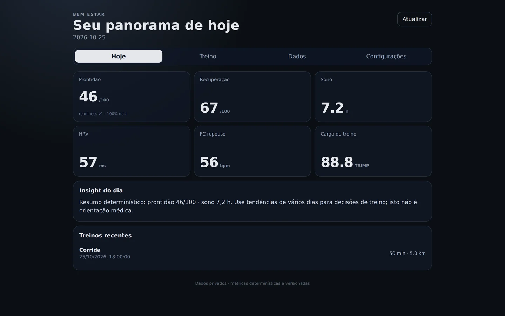
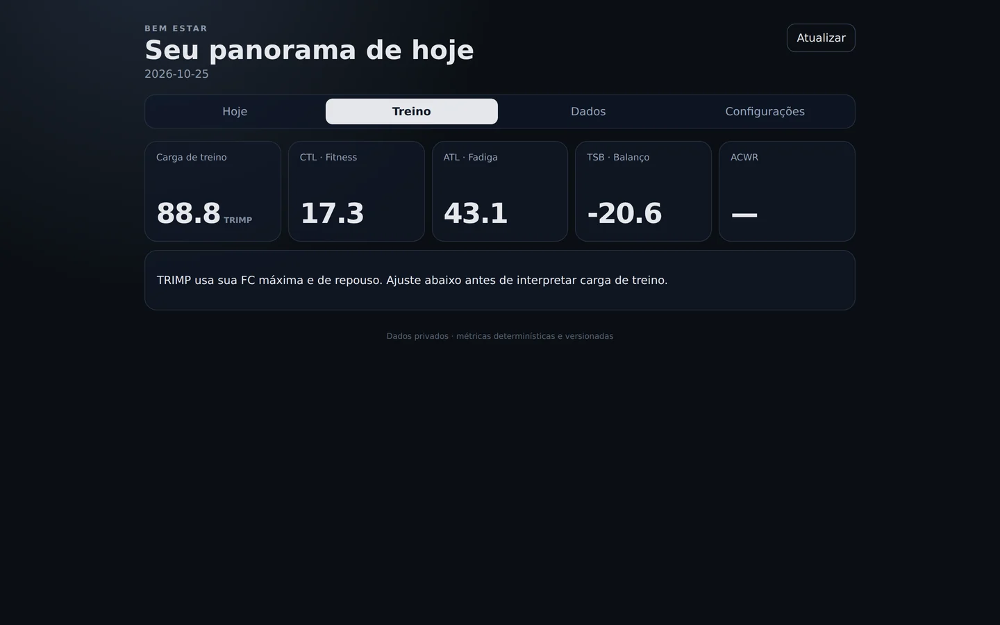
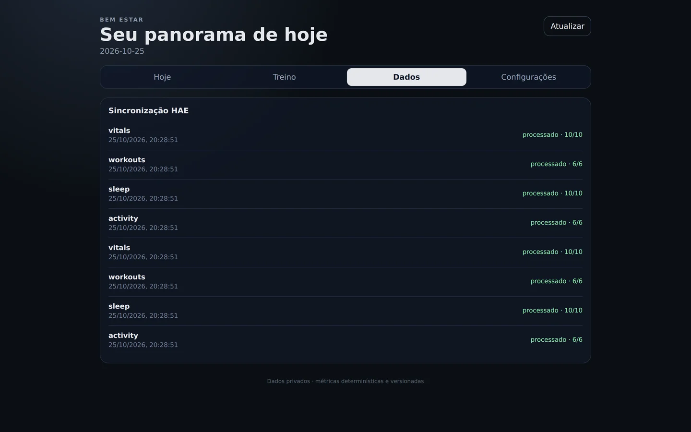
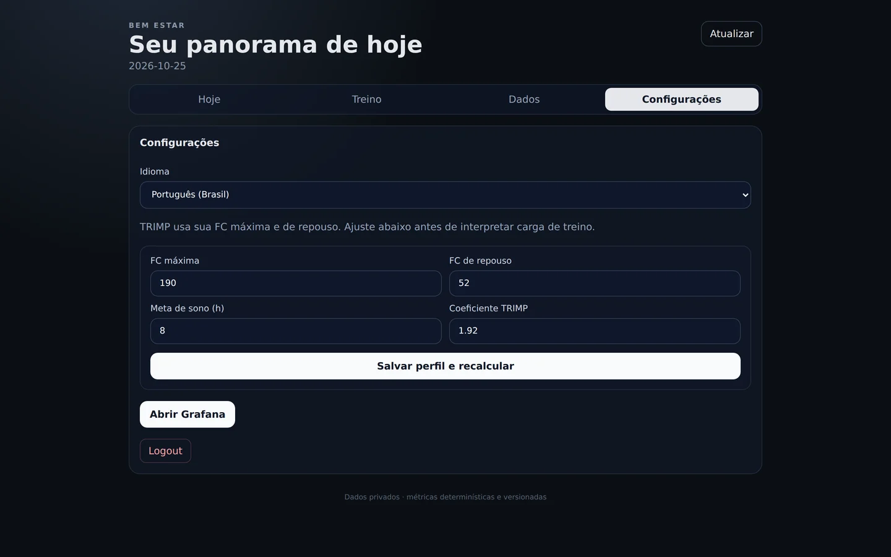
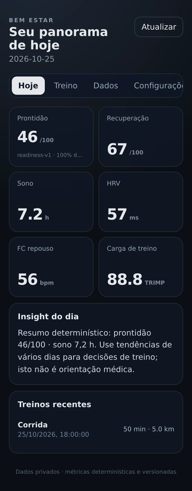
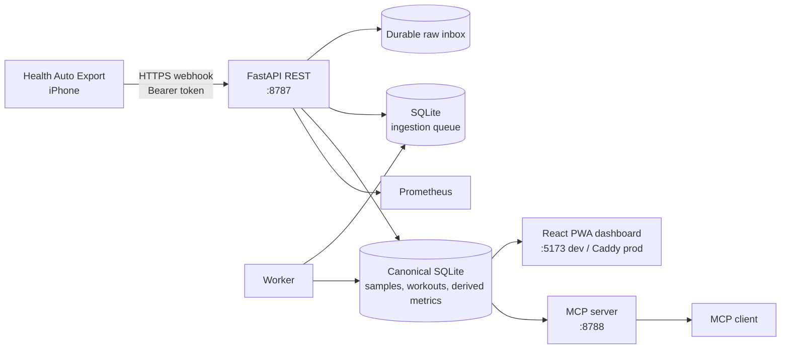

<p align="center">
  
</p>

<h1 align="center">Bem Estar</h1>

<p align="center">
  <strong>Self-hosted Apple Health analytics, a private dashboard, and MCP tools.<br>
  Your health data stays on your box.</strong>
</p>

<p align="center">
  <a href="https://github.com/luiz-izidoro/bem-estar/actions/workflows/ci.yml"></a>
  <a href="https://github.com/luiz-izidoro/bem-estar/actions/workflows/codeql.yml"></a>
  <a href="LICENSE"></a>
  
  
  
</p>

<p align="center">
  
</p>

<p align="center">
  <sub>Dashboard with synthetic demo data. Every screenshot in this README uses seeded, non-personal data.</sub>
</p>

Bem Estar ingests **Apple Health** exports from [Health Auto Export](https://help.healthyapps.dev/),
keeps the raw evidence, normalizes it into a canonical SQLite model, computes **deterministic and
versioned metrics**, and exposes the result through a bilingual dashboard, a REST API, and an
**MCP server** for AI clients.

It is a single-user, local-first platform: no telemetry, no vendor account, no data broker.

> **What it is not:** not a medical device, not a diagnosis tool, and not a hosted service. Metric
> outputs are operational signals for your own routine, not medical advice.

---

## Table of contents

- [Why Bem Estar](#why-bem-estar)
- [Screenshots](#screenshots)
- [What it does](#what-it-does)
- [Quick start](#quick-start)
- [Configuration](#configuration)
- [Architecture](#architecture)
- [Apple Health ingestion](#apple-health-ingestion)
- [REST API](#rest-api)
- [MCP server](#mcp-server)
- [Deployment](#deployment)
- [Security and privacy](#security-and-privacy)
- [Operations](#operations)
- [Troubleshooting](#troubleshooting)
- [Documentation map](#documentation-map)
- [Contributing](#contributing)
- [License](#license)

## Why Bem Estar

| | |
|---|---|
| **Privacy by construction** | Raw payloads, the canonical database and derived metrics live in SQLite on your host. The public surface is a Caddy reverse proxy and the endpoints you choose to expose. |
| **Deterministic, explainable metrics** | Readiness, recovery, sleep, TRIMP, CTL/ATL/TSB and ACWR are computed from explicit formulas and stored with algorithm versions and input hashes. |
| **MCP-native** | The same application services power REST, the dashboard and MCP resources/tools/prompts. AI clients get typed access without a second business-logic layer. |
| **Boring operations** | One SQLite writer, systemd units, Caddy for TLS, Prometheus/Grafana optional. Docker is used only for observability, not for the application runtime. |
| **No subscription** | MIT licensed, self-hosted, and designed for a small VPS or a home server. |

## Screenshots

| Overview | Training load | Ingestion |
|---|---|---|
|  |  |  |

| Profile and settings | Mobile (390 px) |
|---|---|
|  | <p align="center"></p> |

The login screen is intentionally minimal; the dashboard is a PWA-style single-page app with PT-BR
and English strings.

## What it does

| Surface | Capabilities |
|---|---|
| **Ingest** | HAE v2 webhook and compatibility route, bearer-token authentication, streaming body ceiling, durable compressed raw inbox, idempotent ingestion rows, reconciliation updates, worker leases. |
| **Analyze** | Sleep duration/efficiency, HRV and resting-HR baselines, heart-rate zones, TRIMP (Banister/Edwards), CTL/ATL/TSB, ACWR, recovery and morning/live readiness, VO2max and workout trends. |
| **Dashboard** | React + Vite PWA, bilingual PT-BR/EN, readiness/recovery/sleep/HRV/RHR/load cards, training load, ingestion history, profile controls, mobile layout at 390 px. |
| **MCP** | Stateless Streamable HTTP, separate bearer token, tools for summaries/history/sleep/load/workouts/period comparison/ingestion/recompute, resources and prompts. |
| **Operate** | systemd units, Caddy example with body/rate limits, Alembic migrations, backup/restore scripts, 180-day raw retention, Prometheus metrics and Grafana dashboards. |
| **Protect** | Signed HttpOnly session cookie + CSRF, constant-work password verification, bounded rate-limit keys, readiness disk floor, secrets excluded from backups by default. |

## Quick start

### Requirements

- Python **3.12–3.14**
- SQLite **3.35+**
- Node.js **22+** and npm (dashboard only)
- Optional: [`uv`](https://docs.astral.sh/uv/) for the locked dependency set

### 1. Clone and install

```bash
git clone https://github.com/luiz-izidoro/bem-estar.git
cd bem-estar
python3 -m venv .venv
. .venv/bin/activate
pip install -e '.[dev]'
```

For the exact dependency set used by CI and the release gate, use the committed lockfile instead:

```bash
uv sync --frozen --extra dev
```

### 2. Create the environment file

```bash
cp .env.example .env
python scripts/generate_secrets.py
```

The generator prompts for a dashboard password (12+ characters) and prints four lines:
`BEMESTAR_WEBHOOK_TOKEN`, `BEMESTAR_MCP_TOKEN`, `BEMESTAR_SESSION_SECRET` and
`BEMESTAR_DASHBOARD_PASSWORD_HASH`. Replace the four `CHANGE_ME` values in `.env` with those lines.

> `BEMESTAR_TIMEZONE` controls daily aggregation. Set it to your IANA zone (for example
> `America/Sao_Paulo` or `Europe/Lisbon`) before ingesting data.

### 3. Migrate and run

```bash
alembic upgrade head
uvicorn bemestar.interfaces.api.app:create_app --factory --reload --port 8787
```

The first migration creates `var/` and the SQLite database. In a second terminal, start the worker:

```bash
. .venv/bin/activate
python -m bemestar.interfaces.worker
```

Start the dashboard in a third terminal:

```bash
cd dashboard
npm ci
npm run dev
```

Open <http://localhost:5173>, sign in with the dashboard username (`admin` by default) and the
password you chose. The Vite dev server proxies `/api` and `/auth` to the API on port 8787.

### 4. Verify

```bash
curl -fsS http://127.0.0.1:8787/healthz
curl -fsS http://127.0.0.1:8787/readyz
```

Expected: `{"status":"ok"}` and `{"status":"ready","storage":"ok"}`.

Run the full local quality gate:

```bash
make check
```

Build the dashboard for production with `make dashboard-build`. The stricter release gate, which also
checks the empty-database migration and the dashboard build, is:

```bash
./scripts/verify_release.sh
```

## Configuration

All runtime settings use the `BEMESTAR_` prefix and can be supplied through environment variables
or `.env`. The committed [`.env.example`](.env.example) is the source of truth; the table below
covers the settings most operators change.

| Variable | Default | Description |
|---|---|---|
| `BEMESTAR_ENV` | `development` | Set to `production` to require non-placeholder secrets and hide API docs. |
| `BEMESTAR_TIMEZONE` | `America/Sao_Paulo` | IANA zone used for local-day aggregation and sleep boundaries. |
| `BEMESTAR_PUBLIC_BASE_URL` | `http://localhost:8787` | Public origin; `https://` enables `Secure` session cookies. |
| `BEMESTAR_DATABASE_URL` | `sqlite:///./var/bemestar.db` | SQLite URL. Production uses `/var/lib/bem-estar/bemestar.db`. |
| `BEMESTAR_RAW_DIR` | `./var/raw` | Compressed durable inbox for raw HAE payloads. |
| `BEMESTAR_TRUSTED_HOSTS` | `localhost,127.0.0.1` | CSV of allowed `Host` headers (comma-separated, not JSON). |
| `BEMESTAR_CORS_ORIGINS` | `http://localhost:5173` | CSV of allowed browser origins. |
| `BEMESTAR_WEBHOOK_TOKEN` | `CHANGE_ME` | Bearer token for the HAE webhook. Generate it. |
| `BEMESTAR_MCP_TOKEN` | `CHANGE_ME` | Separate bearer token for MCP clients. Generate it. |
| `BEMESTAR_SESSION_SECRET` | `CHANGE_ME` | Signs dashboard session cookies. Generate it. |
| `BEMESTAR_DASHBOARD_USERNAME` | `admin` | Dashboard login name. |
| `BEMESTAR_DASHBOARD_PASSWORD_HASH` | `CHANGE_ME` | PBKDF2 hash produced by `generate_secrets.py`; never store the plaintext password. |
| `BEMESTAR_RAW_RETENTION_DAYS` | `180` | Retention for successfully processed raw payloads. |
| `BEMESTAR_MIN_FREE_DISK_BYTES` | `1073741824` | `/readyz` and webhook reject below this free-disk floor. |
| `BEMESTAR_LLM_BASE_URL` | empty | Optional OpenAI-compatible provider for narrative insights; deterministic fallback stays active. |

Secrets must never be committed. `generated-config/`, `.env`, `var/` and databases are gitignored.
See [`docs/17-PORTALS-AND-CREDENTIALS.md`](docs/17-PORTALS-AND-CREDENTIALS.md) for credential
rotation and production file permissions.

## Architecture



The dependency direction is enforced by `scripts/verify_architecture.py`:

```text
interfaces -> application -> domain
adapters    -> application -> domain
infrastructure may be used by adapters/interfaces bootstrap only
```

- `domain/` is pure Python: metric formulas, entities, no FastAPI, SQLAlchemy, I/O or settings.
- `application/` owns use cases, ports and the repository gateway.
- `adapters/` translate HAE, LLM and notification providers into canonical commands.
- `interfaces/` expose REST, MCP and the worker. They never implement metric formulas.
- SQLite is the only persistence adapter. **One writer** is expected: run one worker and one API
  process per database. Do not share the SQLite file between hosts.

The full model is in [`docs/03-DATA-MODEL.md`](docs/03-DATA-MODEL.md); metric formulas and versions
are in [`docs/04-METRICS-SPEC.md`](docs/04-METRICS-SPEC.md).

## Apple Health ingestion

1. Install **Health Auto Export** on the iPhone and create a **REST API** automation.
2. Point it to `https://<your-host>/webhooks/hae/v2`.
3. Add `Authorization: Bearer <BEMESTAR_WEBHOOK_TOKEN>`.
4. Use JSON export **v2**, enable **Batch Requests**, and set a stream header:
   `X-Bemestar-Stream: vitals | activity | sleep | workouts | history | reconciliation`.
5. Prefer bounded time ranges (for example "Since Last Sync") over multi-year full exports.

The machine-readable plan is in [`config/hae/automation-plan.yaml`](config/hae/automation-plan.yaml);
the step-by-step guide is [`docs/16-HAE-WEBHOOK-SETUP.md`](docs/16-HAE-WEBHOOK-SETUP.md).

```bash
curl -fsS -X POST http://127.0.0.1:8787/webhooks/hae/v2 \
  -H "Authorization: Bearer $BEMESTAR_WEBHOOK_TOKEN" \
  -H "X-Bemestar-Stream: vitals" \
  -H "Content-Type: application/json" \
  --data @tests/fixtures/hae_v2_sample.json
```

The compatibility alias `/v1/health-auto-export` accepts the same payloads during migration.

## REST API

| Endpoint | Purpose |
|---|---|
| `POST /auth/login` | Dashboard login; sets HttpOnly session and CSRF cookies. |
| `GET /api/v1/dashboard/today?day=YYYY-MM-DD` | Daily summary: derived metrics, raw values, versions, workouts. |
| `GET /api/v1/metrics/{metric}?days=30` | Metric history for charting. |
| `GET /api/v1/workouts?days=30` | Recent workouts. |
| `GET /api/v1/ingestions?limit=20` | Ingestion queue/history. |
| `POST /api/v1/admin/recompute` | Recompute derived metrics (CSRF required). |
| `GET /healthz`, `GET /readyz` | Liveness and readiness (disk floor). |
| `GET /metrics` | Prometheus exposition; keep it on loopback. |

Interactive OpenAPI docs are served at `/docs` outside production.

## MCP server

The MCP server exposes the same application services over stateless Streamable HTTP on port 8788.
Use a **separate** bearer token from the HAE webhook.

| Tool | Returns |
|---|---|
| `get_health_summary(day?)` | Readiness, recovery, sleep and load for a local day. |
| `get_metric_history(metric, days)` | Daily values and versions for a metric. |
| `analyze_sleep(day?)` | Sleep duration, efficiency, stages and debt context. |
| `analyze_training_load(day?)` | TRIMP, CTL, ATL, TSB and ACWR. |
| `analyze_workouts(days)` | Workout summaries and per-workout insights. |
| `compare_periods(metric, days_a, days_b, ...)` | Day-aggregated period comparison. |
| `get_ingestion_status(limit)` | Recent ingestion rows and errors. |
| `recompute_metrics()` | Explicit recomputation. |

Example client configuration:

```json
{
  "mcpServers": {
    "bem-estar": {
      "url": "https://bemestar.example.com/mcp",
      "headers": {
        "Authorization": "Bearer ${BEMESTAR_MCP_TOKEN}"
      }
    }
  }
}
```

Example prompts once connected:

- "How is my readiness today? Explain the components and the confidence."
- "Compare my sleep over the last 7 days with the previous 7."
- "Is my training load rising too fast for my history?"

Contract details and OAuth migration notes are in
[`docs/09-API-MCP-CONTRACT.md`](docs/09-API-MCP-CONTRACT.md) and
[`docs/14-MCP-CLIENT-INTEGRATION.md`](docs/14-MCP-CLIENT-INTEGRATION.md).

## Deployment

| Mode | Use it when | Entry point |
|---|---|---|
| Local development | You are evaluating or developing | `make dev`, `npm run dev` |
| systemd + Caddy | You want a private always-on server | [`docs/06-DEPLOYMENT.md`](docs/06-DEPLOYMENT.md), [`docs/18-FIRST-DEPLOY-RUNBOOK.md`](docs/18-FIRST-DEPLOY-RUNBOOK.md) |
| Docker (observability only) | You want Prometheus/Grafana without packaging the app | `observability/docker-compose.yml` |

Production expects Ubuntu 26.04 LTS, Caddy terminating TLS, a dedicated `bem-estar` service user,
`/opt/bem-estar/releases` plus a `current` symlink, `/etc/bem-estar/*.env` and
`/var/lib/bem-estar`. The staging and activation helpers are:

```bash
./scripts/bootstrap_server.sh
./scripts/install_release.sh "$(readlink -f /opt/bem-estar/current-next)"
```

The application intentionally does **not** require Docker. Grafana and Prometheus are optional and
run as containers; the app stays under systemd.

## Security and privacy

> [!IMPORTANT]
> This repository processes health data. Treat the database, raw payloads, backups and environment
> files as sensitive. Never attach them to an issue, pull request or release.

- Dashboard: username/password → signed HttpOnly session cookie; CSRF for mutations.
- HAE and MCP use separate bearer tokens; never reuse one secret across surfaces.
- The API binds to `127.0.0.1`; Caddy is the only public ingress.
- Raw payloads are never served as static files; backups exclude secrets by default.
- Production refuses placeholder secrets and disables API docs.
- Report vulnerabilities privately through GitHub Security Advisories; see [`SECURITY.md`](SECURITY.md).

## Operations

- **Backups:** `scripts/backup.sh` uses SQLite's backup API, compresses raw data, and can copy to an
  off-host rclone target. Restore with `scripts/restore.sh`; test restores on a disposable copy.
- **Retention:** processed raw payloads are pruned after `BEMESTAR_RAW_RETENTION_DAYS`; canonical
  and derived data are kept unless an explicit policy changes that.
- **Readiness:** `/readyz` reports storage and free-disk status; `/metrics` exposes Prometheus
  counters and latency histograms.
- **Logs:** error logs identify ingestion IDs, never payload contents. Raw health data is not logged.

See [`docs/08-OPERATIONS.md`](docs/08-OPERATIONS.md) for timers, backup drills and maintenance.

## Troubleshooting

| Symptom | Likely cause | Fix |
|---|---|---|
| `alembic upgrade head` fails with `unable to open database file` | `var/` is missing and the URL points elsewhere | Use the default SQLite URL or `mkdir -p var`; the app normally creates it. |
| Dashboard login returns 401 | `BEMESTAR_DASHBOARD_PASSWORD_HASH` still `CHANGE_ME` or plaintext password stored | Re-run `generate_secrets.py` and copy the hash, not the password. |
| `SettingsError` for `trusted_hosts`/`cors_origins` | A value was written as JSON instead of CSV | Use `localhost,127.0.0.1` (CSV). Do not wrap the list in brackets. |
| API returns 421 `Invalid host header` | `BEMESTAR_TRUSTED_HOSTS` lacks the public hostname | Add the hostname (comma-separated) and restart the API. |
| `database is locked` | More than one writer/process shares the SQLite file | Run one API and one worker per database. Do not share the file across hosts. |
| Dashboard shows no data | Worker not running or `/today` has no rows | Start the worker, check `/api/v1/ingestions`, then `POST /api/v1/admin/recompute`. |
| MCP returns 401 | Wrong token or HAE token used | Use `BEMESTAR_MCP_TOKEN`, not the webhook token. |

## Documentation map

| Document | Contents |
|---|---|
| [`docs/01-FUNCTIONAL-SPEC.md`](docs/01-FUNCTIONAL-SPEC.md) | Product scope, actors, functional requirements. |
| [`docs/02-ARCHITECTURE.md`](docs/02-ARCHITECTURE.md) | Layers, dependency rules, process topology. |
| [`docs/03-DATA-MODEL.md`](docs/03-DATA-MODEL.md) | Canonical tables, identities, migrations. |
| [`docs/04-METRICS-SPEC.md`](docs/04-METRICS-SPEC.md) | Metric formulas, versions and parameters. |
| [`docs/06-DEPLOYMENT.md`](docs/06-DEPLOYMENT.md) | Deployment layout and cutover. |
| [`docs/07-SECURITY.md`](docs/07-SECURITY.md) | Threat model and controls. |
| [`docs/08-OPERATIONS.md`](docs/08-OPERATIONS.md) | Backups, retention, observability, maintenance. |
| [`docs/09-API-MCP-CONTRACT.md`](docs/09-API-MCP-CONTRACT.md) | REST/MCP contracts. |
| [`docs/16-HAE-WEBHOOK-SETUP.md`](docs/16-HAE-WEBHOOK-SETUP.md) | iPhone automation setup. |
| [`docs/17-PORTALS-AND-CREDENTIALS.md`](docs/17-PORTALS-AND-CREDENTIALS.md) | Credentials and rotation. |
| [`docs/18-FIRST-DEPLOY-RUNBOOK.md`](docs/18-FIRST-DEPLOY-RUNBOOK.md) | First production deploy. |
| [`docs/19-AUDIT-REPORT.md`](docs/19-AUDIT-REPORT.md) | Hardening audit. |
| [`docs/20-PUBLICATION.md`](docs/20-PUBLICATION.md) | GitHub settings and publication checklist. |
| [`docs/README.md`](docs/README.md) | Full documentation index. |
| [`NOTICE.md`](NOTICE.md) | License scope and third-party attribution. |
| [`AGENTS.md`](AGENTS.md) | Operating contract for AI coding agents. |

## Contributing

See [`CONTRIBUTING.md`](CONTRIBUTING.md) for setup, architecture rules, metric-change protocol and
the pull-request checklist. Security reports must follow [`SECURITY.md`](SECURITY.md) and must not
be filed as public issues.

## License

MIT. See [`LICENSE`](LICENSE). License scope and third-party attribution are in
[`NOTICE.md`](NOTICE.md) and [`THIRD_PARTY_NOTICES.md`](THIRD_PARTY_NOTICES.md).

Bem Estar is independent and is not affiliated with, endorsed by, or sponsored by Apple Inc.,
Health Auto Export, or any MCP client vendor. Apple Health and Apple Watch are trademarks of
Apple Inc.; product names are used descriptively only.
