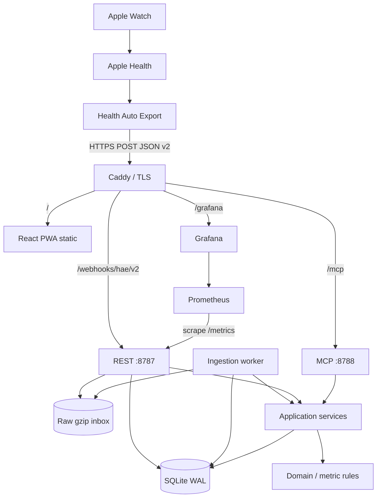
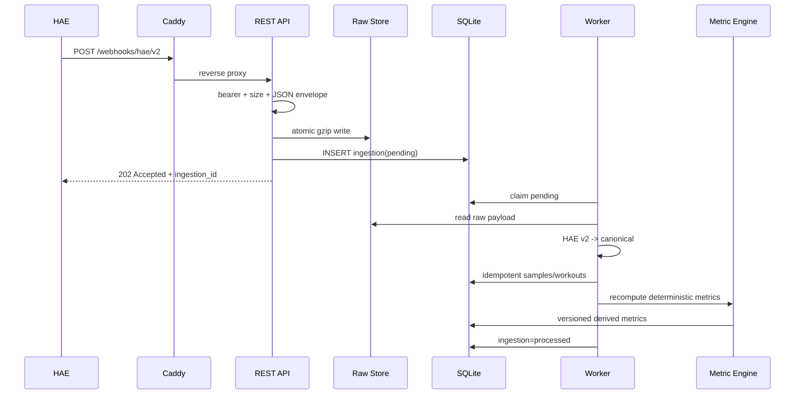
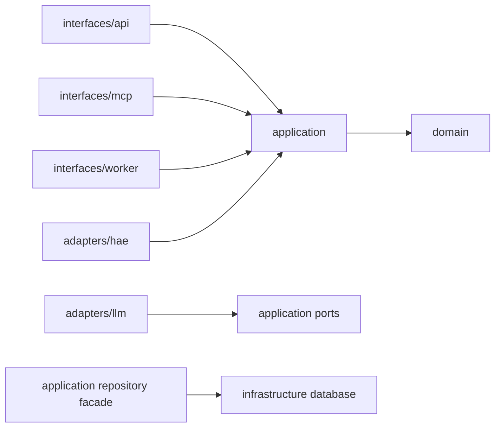

# Architecture

## Architectural style

**Modular monolith, ports/adapters (hexagonal) with process separation at inbound interfaces.**

The application is one codebase and one database. API, worker and MCP are separate processes for isolation, not separate services with independent business models.



## Request lifecycle



## Dependency direction



`domain/` must remain framework-free. See `AGENTS.md`.

## Why not microservices

The target is one owner, one 4 GiB VM, one source, low write concurrency, and analytics that benefit from transactional proximity. Microservices would add network failure modes, secret distribution, deployment coordination, observability overhead, and resource consumption without providing a scaling benefit.

## Why SQLite

- single-owner workload
- WAL supports concurrent readers + one writer
- low operational overhead
- native backup API
- easy to inspect/recover
- repository/application seams preserve a future PostgreSQL migration path

Revisit only if measured write contention, database size, or multi-user requirements justify it. This requires an ADR.

## Why separate MCP process

MCP and REST share application code but not process lifecycle. Benefits:

- MCP SDK upgrades cannot break webhook availability.
- MCP auth/transport changes remain isolated.
- resource limits/restarts can differ.
- REST remains small and boring.

## Why no in-request parsing

HAE background execution has device/network constraints. Returning `202` after durable acceptance minimizes mobile timeout risk and makes server processing replayable.

## Runtime topology on target VM

```text
Caddy :80/:443
  ├─ /api, /auth, /webhooks, /healthz, /readyz -> 127.0.0.1:8787
  ├─ /mcp -> 127.0.0.1:8788
  ├─ /grafana -> 127.0.0.1:3000
  └─ / -> /opt/bem-estar/current/dashboard/dist

systemd
  ├─ bem-estar-rest.service
  ├─ bem-estar-worker.service
  └─ bem-estar-mcp.service

Docker (optional operational plane only)
  ├─ prometheus (host network, 127.0.0.1:9090)
  └─ grafana    (host network, 127.0.0.1:3000)

Persistent
  ├─ /var/lib/bem-estar/bemestar.db
  ├─ /var/lib/bem-estar/raw/
  └─ /var/backups/bem-estar/
```
