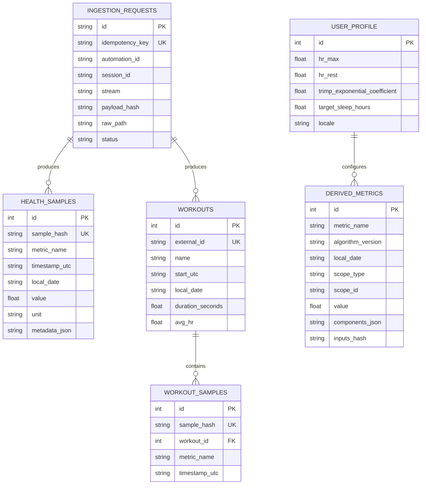

# Data Model

## Principles

1. Raw evidence is immutable during its retention period.
2. External HAE shape is converted at the adapter boundary.
3. UTC is stored for event chronology; `local_date` supports user-local aggregation.
4. Idempotency is deterministic.
5. Derived semantics are versioned.



## Sample dedupe key

`sample_hash = SHA256(canonical JSON)` over metric name, event timestamps, local date, scalar/text value, unit, source and retained source metadata.

This deliberately makes a materially changed HAE record a new canonical record rather than silently overwriting evidence. If a future source supplies stable sample IDs, an ADR may add source-specific identity.

## Ingestion idempotency key

`SHA256(automation-id | session-id | payload_hash)`.

HAE reconciliation sends may contain already-known samples: request acceptance is not considered an error; canonical inserts ignore already-known hashes.

## Workout identity

Use HAE v2 `workout.id`. If absent, generate a stable hash of type + start + end.

## Derived metric uniqueness

`metric_name + algorithm_version + local_date + scope_type + scope_id`.

A formula change creates a new algorithm version; it must not silently overwrite the semantic history of the previous version.

## Raw store

```text
/var/lib/bem-estar/raw/YYYY/MM/DD/HHMMSS_<stream>_<hash16>.json.gz
```

Never expose this directory to the web server. Retention defaults to 180 days on the current VPS. The daily maintenance timer prunes only processed RAW payloads; canonical data is retained. Off-host backup policy should cover evidence that must outlive local RAW retention.
